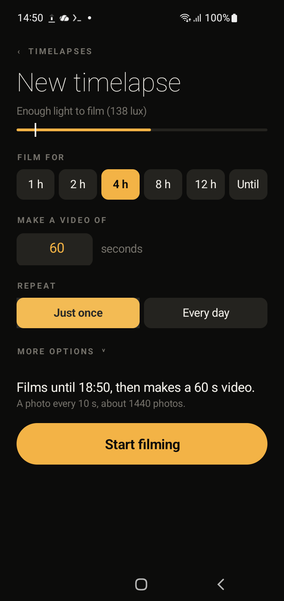

# Timelapse for Android

Put an old phone on a stand. It takes photos on its own, even with the screen locked, and turns them into a timelapse video. You pick two things: how long to film and how long the video should be. The app works out the rest.

No account, no cloud, no ads. Everything stays on the phone. You can also control it from your computer over your home Wi-Fi.

<p align="center"></p>

## What it does

- **Two questions only.** Film for 1 to 12 hours (or until a clock time). Make a video of any length in seconds (1 minute at first, then the last length you used). The time between photos is calculated for you.
- **Works with the screen locked.** Runs start from an alarm, so the phone can sleep until it is time.
- **Light-aware.** In "Only when bright" mode it skips photos that are too dark to see anything. A dim room lit by a laptop still counts as bright enough.
- **Every day, by itself.** Set a start time, an end time and a video length. The phone films and builds the video each day, and deletes old ones after 7, 14 or 30 days.
- **Library.** Scrub the photos, play the video, share, rename or delete. Every delete asks first.
- **Control from a computer.** The Library shows a link on your Wi-Fi. Open it in any browser to start and stop, set the daily plan, watch and download videos.

## Install

Download `timelapse.apk` from the [latest release](../../releases/latest) and open it on your phone (allow "install unknown apps" when asked). Or build it yourself, see below.

Needs Android 12 or newer (minSdk 31). Built and tested on a Samsung Galaxy S10.

For daily runs the app asks for two permissions: **Alarms & reminders** and **Display over other apps**. Android only gives the camera to an app that has a screen, so the app opens a see-through screen for the moment it takes a photo.

## Control it from your computer

The Library screen shows a link like `https://192.168.1.50:47831/?k=<key>`. Tap it to copy, then paste it in a browser on a computer on the same Wi-Fi.

- The 12-character key in the link is the password. Anyone with the link on your network can control the app, so do not share it.
- The page uses HTTPS with a certificate the phone makes for itself. Your browser will say "Not secure" the first time. Click Advanced, then Continue. The traffic is still encrypted.
- Screens have their own addresses (`#/`, `#/new`, `#/t/<id>`), so the browser Back button works.

## How it works

- Interval = video seconds x 24 fps, spread over the run length, clamped between 3 s and 300 s.
- Start and daily runs use `setAlarmClock` and open an invisible `RunActivity` to get the camera in the background. A foreground service takes the photos.
- Photos go to `Pictures/Timelapse/<session>/` and videos to `Movies/Timelapse/<session>.mp4`.
- The web page is a single file, `app/src/main/assets/index.html`, served by a small TLS server inside the app (`WebService.java`). The certificate is built by hand, so the app has no libraries.
- Plain Java, no dependencies, programmatic UI.

## Build and install

You need JDK 21, the Android SDK and Gradle.

```sh
echo "sdk.dir=$HOME/Library/Android/sdk" > local.properties
gradle assembleDebug
adb install -r app/build/outputs/apk/debug/app-debug.apk
adb shell appops set com.faka.timelapse SCHEDULE_EXACT_ALARM allow
adb shell appops set com.faka.timelapse SYSTEM_ALERT_WINDOW allow
```

Quick test from adb (2 minutes, a photo every 3 s):

```sh
adb shell am start -n com.faka.timelapse/.MainActivity --ez autostart true --ei minutes 2 --ei interval 3
```

## Known limits

- After a phone reboot, the first scheduled start may not get the camera. The next day's run works.
- The web page has no multi-select yet.

## License

[MIT](LICENSE)

## Support

If this project is useful to you, you can support my work:

[](https://ko-fi.com/zfaka)
